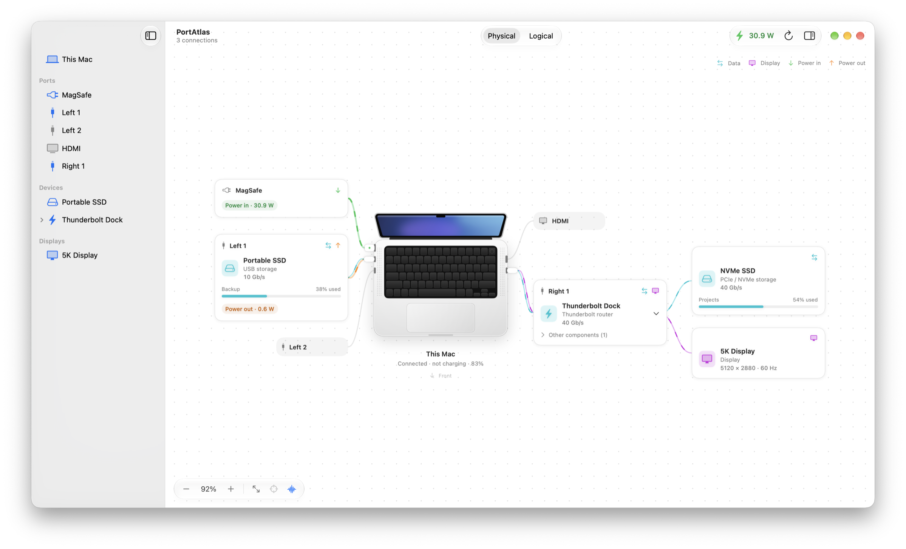
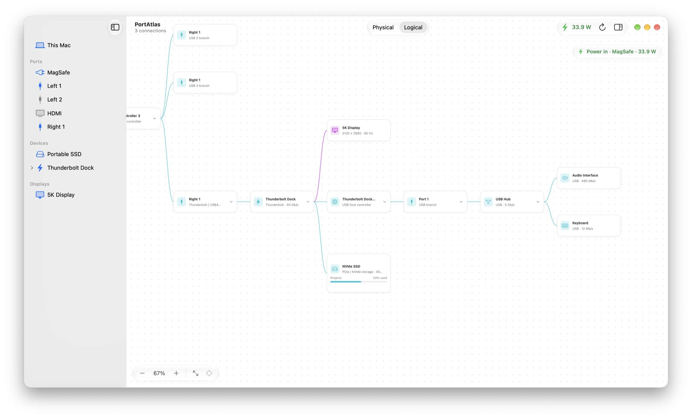
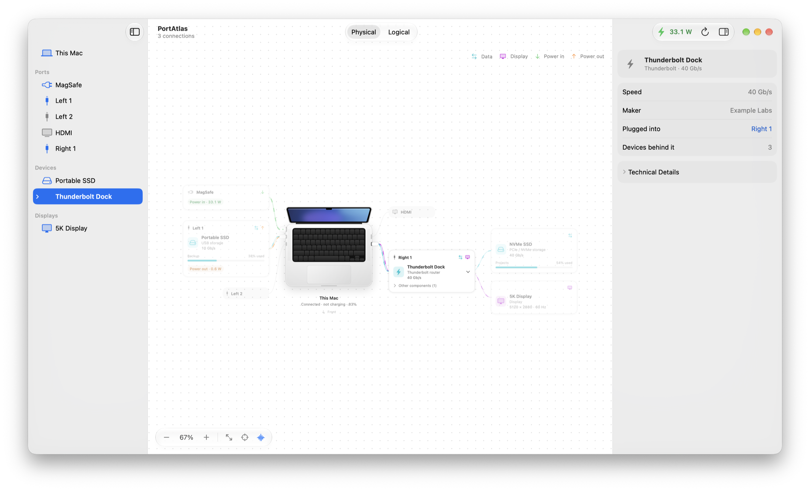

# PortAtlas

See what is plugged into your Mac, which port it is in, and what each connection is doing: data, displays and power.

**Version 1.0.0 · Apple Silicon · macOS 26 or later.** PortAtlas reads local hardware information only. It has no network services, accounts or analytics.

<picture>
  <source media="(prefers-color-scheme: dark)" srcset="Docs/Images/physical-dark.png">
  
</picture>

## Download

Get **PortAtlas-1.0.0.dmg** from [Releases](https://github.com/shirizhaki/PortAtlas/releases), open it, and drag PortAtlas to Applications. Release builds are signed with a Developer ID and notarized by Apple, so macOS opens them without a security warning.

## What it shows

- **Physical map.** Your Mac, drawn as the model it is (MacBook, Mac mini, Mac Studio, iMac or Mac Pro), with every port in place. Connected devices hang off the port they use, and docks show what is attached through them.
- **Logical map.** The tree macOS reports: controllers, USB 2, USB 3 and Thunderbolt branches, hubs and devices. A dock appears under the Mac port it is plugged into.
- **Live connections.** Wires are colored by what they carry: teal for data, purple for displays, green for power coming in and orange for power going out to accessories.
- **Power.** Live power input, which port is charging the Mac, the charger's limit, battery level, and power supplied to accessories where the Mac reports it.
- **Displays.** The signal resolution and refresh rate actually sent to each display, separate from the desktop size macOS scales to.
- **Storage.** Mounted volumes and free space on connected drives.
- **Inspector.** Select anything for a plain-language summary. Everything technical, from negotiated voltages to EDID, is one click away in Technical Details.

<picture>
  <source media="(prefers-color-scheme: dark)" srcset="Docs/Images/logical-dark.png">
  
</picture>

<picture>
  <source media="(prefers-color-scheme: dark)" srcset="Docs/Images/inspector-dark.png">
  
</picture>

## Getting started

macOS reports which connector a device uses, but not whether that connector is on the left or the right. Name your ports once:

1. Choose **Match Ports…** in the sidebar or in **PortAtlas → Settings** (⌘,).
2. Plug one USB device straight into a port on the Mac, not into a hub or dock.
3. Confirm the side and name, then **Save Position**. Move the device to the next port and repeat.

MagSafe and a built-in HDMI port are found automatically. You can rename and reorder ports in Settings at any time.

**Navigating:** two-finger scroll pans, pinch or ⌘-scroll zooms, ⌘1 and ⌘2 switch maps, ⌘0 fits everything, ⌘L centers the selection, and Escape closes the inspector.

## Accuracy

PortAtlas only shows what macOS reports and leaves anything ambiguous unassigned rather than guessing.

- Speeds are the negotiated link rate, not measured transfer speed.
- Charger figures are the agreed power limit, not what the Mac is drawing. The live power-in reading is measured separately.
- Which port is charging the Mac is inferred from its power contract and labeled as such.
- Identical displays, virtual screens or missing driver details can leave a display's route unavailable.
- Hands-on testing so far covers one Apple Silicon MacBook Pro with USB storage, a Thunderbolt dock, displays and charging; other Macs are covered by automated fixtures. See the [hardware validation checklist](Docs/HardwareValidation.md).

PortAtlas never writes to or resets devices. Discovery uses public IOKit interfaces and a read-only connection to the Mac's power sensors.

## Privacy

Nothing leaves your Mac. Port names and layout choices are stored locally:

- Port names and positions: `~/Library/Application Support/PortAtlas/ports.json`
- Dock layout choices: `~/Library/Application Support/PortAtlas/presentation.json`

Display identities, power history and hardware snapshots are kept in memory only. Delete those two files to start fresh.

## Build from source

Requires Xcode 26 or later. No external packages are downloaded.

Open `PortAtlas.xcodeproj` and run the **PortAtlas** scheme, or from Terminal:

```sh
swift build
./Scripts/test.sh
./Scripts/build-app.sh
open build/PortAtlas.app
```

`build-app.sh` produces a locally signed app with its Liquid Glass icon. To build a signed, notarized disk image, install a Developer ID Application certificate, save notarization credentials once with `xcrun notarytool store-credentials PortAtlas`, then run `./Scripts/release.sh`.

Debug builds accept `-demoTopology YES` to show invented example hardware, which is how the screenshots above were made; demo mode never touches saved settings.

Before sharing source or history, run `python3 Scripts/package-source.py --check-git-history`. It blocks personal paths, credentials and unapproved email addresses, and requires every commit to use an approved identity and UTC time.

```text
Sources/PortAtlasCore/        Models, topology, matching and persistence
Sources/PortAtlasHardware/    Read-only discovery and telemetry
Sources/PortAtlasApp/         SwiftUI app
Sources/PortAtlasDiagnostics/ Read-only diagnostics
Tests/PortAtlasCoreTests/     Synthetic fixtures and regression tests
Packaging/                    Info.plist, privacy manifest and Icon Composer icon
Docs/                         Architecture, evidence and hardware validation
```

## Contributors

- [@shirizhaki](https://github.com/shirizhaki): creator, product direction, design and hardware testing.
- [@codex](https://github.com/codex) (OpenAI Codex): original implementation, debugging and testing.
- [@claude](https://github.com/claude) (Anthropic Claude): 1.0 redesign, performance and reliability work.

## License and acknowledgements

PortAtlas is released under the [MIT License](LICENSE), copyright 2026 PortAtlas contributors.

Some discovery and power-reading code is adapted from [WhatPort](https://github.com/darrylmorley/whatport) by Darryl Morley, also MIT licensed. Its notice is in [ThirdPartyNotices/WhatPort-LICENSE.txt](ThirdPartyNotices/WhatPort-LICENSE.txt) and ships inside the app. See the [adaptation details](Docs/ThirdParty.md).

See also the [architecture notes](Docs/Architecture.md), [capability evidence](Docs/PortCapabilities.md) and [contributing guide](CONTRIBUTING.md).
